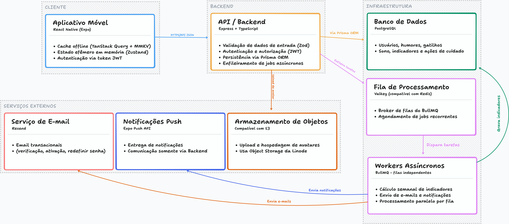

# Nexo

Nexo é um aplicativo de monitoramento de humor para pessoas com
transtorno bipolar, e também um trabalho de conclusão de curso. Ele
parte de uma pergunta simples e teimosa: como perceber o próprio estado
emocional quando ele muda depressa, e o que ajuda a explicá-lo?

Registrar "como eu estou" é só o começo. A proposta é guardar também o
contexto em volta do registro — o que aconteceu, como estavam o corpo e
a cabeça, o que veio depois. Com o tempo, esses fragmentos formam uma
linha do tempo que dá para reler e onde dá para enxergar padrões.

Originalmente o app seria 100% offline; por exigência do curso, porém,
passou a contar com um backend, então esta versão funciona com uma API
implantada.

> Nota histórica: o nome original do projeto era **orbit**. É normal
> encontrá-lo por aí em algum arquivo de código ou string esquecida.

## O que é o EMA

O Nexo se apoia no EMA — *Ecological Momentary Assessment*, ou avaliação
ecológica momentânea. Em vez de pedir que a pessoa reconstrua o dia
inteiro de memória no fim da noite, o EMA propõe capturar o estado no
momento em que ele acontece, no ambiente cotidiano e não no consultório.

Na prática, isso muda o que o app pergunta. Ele não quer ser um diário
genérico nem um placar de humor; quer registrar o instante e os seus
arredores. É isso que permite, mais tarde, comparar tendências, cruzar
sono e energia, e notar quais situações tendem a se repetir.

## Funcionalidades

- **Humor** — registro rápido ou detalhado, com energia, ansiedade e
  estresse (escala de 0 a 10), emoções com intensidade e anotação livre.
- **Gatilhos** — eventos do dia a dia por categoria, que podem ser
  vinculados a um humor com o impacto percebido de cada um.
- **Sono** — registro diário de horas e qualidade.
- **Ações de cuidado** — medicações, consultas e atividades, que também
  podem se ligar a humores e gatilhos.
- **Medicamentos** — regimes recorrentes com horários, uma visão do
  "hoje" para confirmar doses e lembretes automáticos.
- **Histórico** — um feed único e cronológico de tudo, com filtros por
  tipo.
- **Jornada** — tendência de humor, correlação entre sono e energia,
  padrões de gatilho e resumos diários, gerados periodicamente.
- **Relatório** — um PDF "clínico" do período (até 90 dias) para levar à
  consulta.
- **Exportação** — todos os dados em CSV, enviados por e-mail.

## Estrutura do monorepo

```sh
nexo/
├── api         # servidor Express + Prisma
├── frontend    # app React Native (Expo)
├── monografia  # a tese, em LaTeX
├── docs        # decisões (ADRs) e notas de trabalho
├── ansible     # provisionamento do servidor
└── docker-compose.yml
```

## Arquitetura

- **API** — Express, Zod e Prisma sobre PostgreSQL; BullMQ com Valkey
  para tarefas em segundo plano; Resend para e-mail e Expo para
  notificações.
- **Mobile** — React Native (Expo), expo-router, React Query com cache
  persistido em MMKV e Zustand para o estado efêmero.
- **Infra** — Docker Compose no dia a dia e Ansible para o servidor;
  GitHub Actions cuida do deploy da API e da publicação da tese.



## Como rodar localmente

Pré-requisitos: Docker e o Expo CLI.

```sh
# sobe banco, fila e API
docker compose up -d db valkey api

# cria dados de exemplo
cd api && npm run seed
```

O app móvel usa um *development build* por conta de dependências nativas, então logue com a conta do expo, gere uma build e depois basta rodar o comando:

```sh
cd frontend
npm install
cp .env.example .env.local   # aponte a base da API para o IP da máquina
eas build # apenas para gerar a build de desenvolvimento
npx expo start # uso normal
```

## Testes

A API usa Vitest e roda dentro do container, porque o banco de teste
vive na rede do Compose:

```sh
docker compose exec api npm run test:setup
docker compose exec api npm test
```

No mobile há fluxos de fumaça com Maestro, que roda num aparelho Android
físico. Vale dizer que isso ainda é experimental: exige o Maestro e o `adb`
instalados, além de um device conectado.

```sh
cd frontend && npm run test:e2e
```

## Monografia

A tese que acompanha o projeto vive em `monografia/`, escrita em LaTeX.
A edição costuma ser feita no Vim com o **vimtex**, que cuida de
compilar enquanto se escreve.

## Licença

Por ser um projeto acadêmico, ele não é plenamente livre: o IFSul
reserva uma parcela de autoria ao orientador, ao aluno e à instituição.

Ainda assim, na medida do possível, o código está sob os termos da
GPL-3.0-only e o texto sob a CC BY-NC-SA 4.0. Na prática: a tese pode
ser lida, citada e compartilhada, mas não pode ser vendida nem usada
comercialmente.
